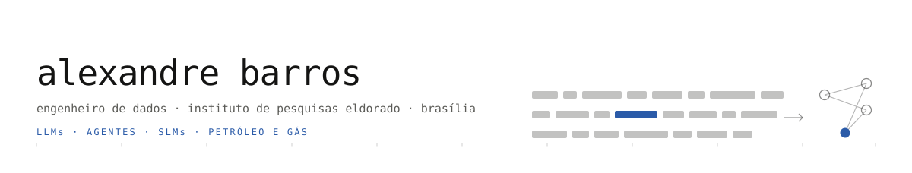

<picture>
  <source media="(prefers-color-scheme: dark)" srcset="header-dark.svg">
  
</picture>

Engenheiro de dados no **Instituto de Pesquisas Eldorado**, em Brasília. Construo sistemas de IA — LLMs e agentes — para o domínio de petróleo e gás, junto com a infraestrutura de dados que sustenta esses sistemas.

Pesquiso SLMs: modelos pequenos, rodando perto do dado, onde o modelo grande não cabe ou não convém.

Economista de formação, engenheiro de dados na prática. A economia me deu as perguntas; a engenharia, a forma de responder em escala.

## agora

- **Instituto de Pesquisas Eldorado** (Brasília) — IA aplicada a óleo e gás: LLMs, agentes e pipelines de dados.
- **Pesquisa em SLMs** — small language models e o que eles resolvem melhor que os grandes.
- **Pós-graduação em Dados e IA**, em andamento.

## stack

**IA, LLMs e agentes**

**Dados e análise**

**Lakehouse e orquestração**

**Plataforma**

<picture><source media="(prefers-color-scheme: dark)" srcset="icons/aws-dark.svg"></picture>

**Aplicação e automação**

## contato

[alexand7e.dev.br](https://alexand7e.dev.br) · [LinkedIn](https://linkedin.com/in/alexand7e) · [X](https://x.com/alexandr_eb) · <contato@alexand7e.dev.br>
